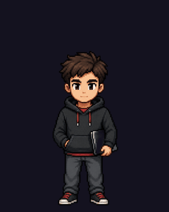
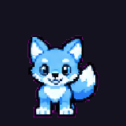
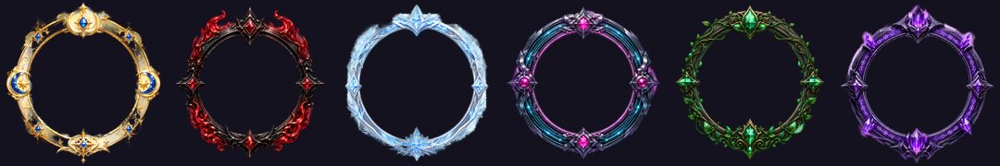
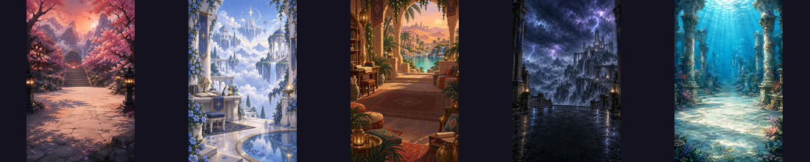

  

  

Solo Grind turns your real goals into an RPG. Your tasks become quests, and focused work sessions earn XP. Your character, skills and role grow with the work you actually do. When you want a break, step into **Solvale**, a shared village world where you can explore, farm, cook, fish and battle summons with other players.

## ⚔️ Focus and progression

- **Quests:** daily, main, side and boss quests, with priorities, due dates and repeating schedules. Solo Grind works out the difficulty and XP reward for you.
- **Boss quests:** split a big project into objectives and watch the boss's HP bar drop as you finish each one.
- **Grind sessions:** you complete quests by actually putting in focused time, not by clicking a button.
- **Skills and roles:** level up skills in six categories. A real-life role, such as Hard Coder, Athlete or Musician, emerges on its own from the skills you train.
- **Daily Adventures:** a short, curated playlist of quests that fits the time you have today.
- **Learning Paths:** turn a big goal into a roadmap of milestones.
- **Planning tools:** a journal, weekly review, quest templates, a planner and a calendar.
- **Achievements:** dozens of achievements, with tiers from Bronze to Legendary.

   
  Your role avatar evolves at levels 1, 10, 25, 50 and 100.

## 🤖 Kairos, your mentor

Kairos is a built-in AI mentor. It greets you, suggests quests and chats with you about your progress.

## 📚 Study and research

- **Study Raids:** questions, flashcards and mistake drills built from your own study material.
- **Research:** keep your files organized, with version history and notes.

## 🏘️ Solvale

A shared village world to explore with other players:

- Roam freely, fish, farm, cook, clean and visit other players' homes
- Take on repeatable missions and earn bronze, silver and gold
- Shop at the village market stalls
- Collect **summons**, battle them in turn-based fights, teach them new moves, use potions and evolve them
- Show off a title on your nameplate and climb the summoner leaderboard

  

   
  Summons evolve through five stages.

## 👥 Social play

- Friends, persistent parties and co-op **Party Raids** against shared bosses
- PvP modes: Territory Clash, Consistency Arena, Boss Race and Focus Showdown
- Direct and group messages with attachments, voice messages and chat themes
- Weekly leaderboards with your friends

## 🎨 Style your character

Role avatars that evolve as you level up, plus cosmetic avatars, frames, auras, backgrounds, timer skins and saved loadouts. You earn **Grind Tokens** from your focus time and spend them in the shop.

   
   
  

## 🚀 Coming soon

- A Solvale mobile app
- More summon elements and battle mechanics
- In-app announcements and events

---

## 📄 License

Copyright © 2026 Solo Grind. All rights reserved.

This project is proprietary. You may not copy, modify, distribute or use the source code, artwork, or design without written permission from the owner.
